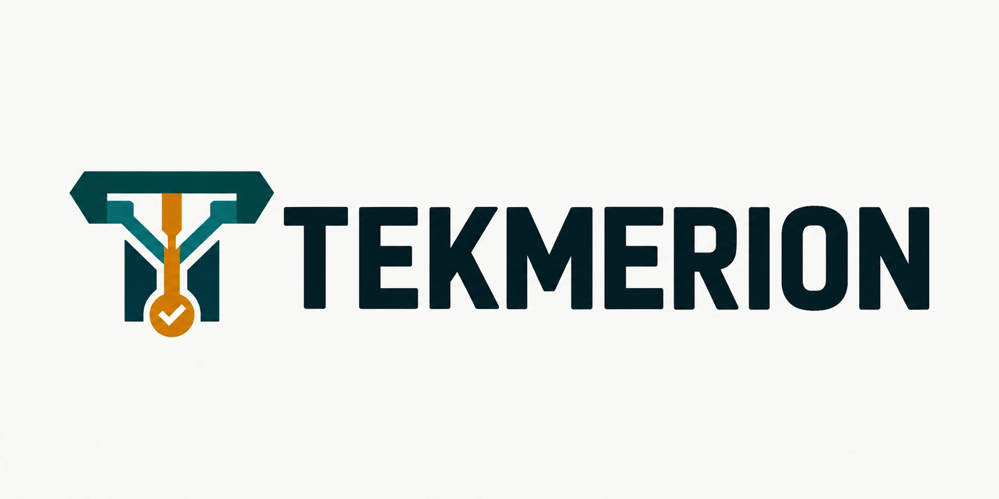

<p align="center">
  
</p>
<p align="center">
  <a href="https://github.com/tswierszcz/tekmerion/actions/workflows/ci.yml"></a>
</p>

# Tekmerion

LLM-assisted vulnerability research for open-source JVM libraries. Combines Ariadne's reachability analysis with static analysis and targeted testing to generate hypotheses, investigate attack paths, and produce reproducible evidence of security flaws.

The project is in early implementation. The [implementation plan](IMPLEMENTATION_PLAN.md) defines the first pilot, evidence formats, integration milestones, and acceptance criteria.

Tekmerion starts with a pinned library revision, a reproducible build, and a threat model. It discovers candidate security properties, generates hypotheses from source and API context, evaluates static evidence, and runs focused experiments through the library's public API. Findings record the suspected defect, reachability, and observed security effect as separate assessments.

[Ariadne](https://github.com/tswierszcz/ariadne) provides JVM graphs, API entry points, path evidence, and model gaps. Tekmerion owns LLM workflows, source analysis, test generation, experiment execution, and research reports. The integration uses a versioned CLI and JSON contract.

The first milestone is the shared contract and a local fixture-backed workflow. The first pilot covers one library and one vulnerability class, including a control variant and a reproducible test.

The [Ariadne integration contract](docs/ARIADNE_CONTRACT.md) documents the protocol, evidence states, version pin, the Go adapter in `internal/ariadne` and how to test it against a real Ariadne build.

[Target preparation](docs/TARGET_PREPARATION.md) (TM1) builds a pinned revision under a declared recipe, records the run manifest, maps Ariadne method identities to source lines and indexes the result with Ariadne: `go run ./cmd/tekmerion prepare -project testdata/control/project.json ...`.

The [Recon → Hunt → Validate implementation plan](docs/RESEARCH_HARNESS_IMPLEMENTATION_PLAN.md) defines the next increments, adapting selected Cloudflare security-audit practices to Tekmerion and Ariadne.

The bounded model gateway uses [OpenRouter](https://openrouter.ai), with explicit models/providers for Recon, Hunt and Validate. Offline cost estimates, durable reservations and spending reconciliation are implemented. Prepared-source Recon, bounded Hunt and static triage are implemented below. Checked-in runtime experiments are implemented below. Independent validation and the final report export are implemented below. Generated harnesses, the real-library pilot, catalogue refresh and bounded calibration remain planned.

Planned research inputs include a supplied JVM binary, pinned source and an optional CVE evidence package. Runs can confirm a known issue and search for distinct variants under separate budgets. Final exports are Markdown/JSON reports with linked evidence and reproducers; the [harness plan](docs/RESEARCH_HARNESS_IMPLEMENTATION_PLAN.md) defines the input and report contracts.

## Durable fixture audit (RH-T1, first increment)

The local fixture workflow now persists one run per state directory in SQLite, with immutable hash-addressed evidence, exclusive task leases and append-only attempt/result history. It exercises nine pinned Ariadne contract pairs. It is a static integration fixture, not an audit of a real target or an LLM research workflow.

Builds now require `CGO_ENABLED=1` and a C compiler. [CI](.github/workflows/ci.yml) runs gofmt, vet, build and `go test -race` on both supported Go release lines (1.26 and 1.27) plus `govulncheck`; the real Ariadne and sandbox integration tests skip there and run locally with `ARIADNE_SRC` set. The pinned SQLite driver is [`github.com/mattn/go-sqlite3 v1.14.32`](https://github.com/mattn/go-sqlite3/tree/v1.14.32); its [build requirements and connection options](https://github.com/mattn/go-sqlite3/blob/v1.14.32/README.md#installation) were checked before selection. The module minimum is Go 1.26.11, a supported release with current security fixes; older toolchains download it automatically under the default `GOTOOLCHAIN=auto`.

Run from the repository root; the state directory must not already exist:

```sh
go run ./cmd/tekmerion audit -fixture -state /tmp/tekmerion-fixture-run
go run ./cmd/tekmerion status -state /tmp/tekmerion-fixture-run
go run ./cmd/tekmerion resume -state /tmp/tekmerion-fixture-run
go run ./cmd/tekmerion report -state /tmp/tekmerion-fixture-run > /tmp/tekmerion-fixture-run/report.md
go run ./cmd/tekmerion report -state /tmp/tekmerion-fixture-run -format json > /tmp/tekmerion-fixture-run/report.json
```

`audit` requires explicit `-fixture`; `-contract DIR` selects a pinned contract package (default `contracts/ariadne/v1`, with its sibling `PIN.json`). The complete request queue and manifest are committed before execution. `resume` preserves completed work and verifies that the saved pin still matches the package. A live lease is never forcibly stolen. After a hard stop, wait for its one-minute fixture lease to expire before resuming; the next claim records the old attempt as interrupted. An interrupted attempt can be retried immediately when its owner commits a graceful interruption. Failed tasks remain terminal and diagnostic evidence remains available.

State schema `tekmerion-state-7` automatically migrates version-1 through version-6 ledgers while preserving inputs, attempt history and budget accounting. State lives in `state.sqlite` (plus SQLite WAL files), with complete evidence bytes in `artifacts/<sha256-hex>`. Keep the directory together; use a SQLite-aware backup if copying while a writer is active. Raw responses, diagnostics, validation scope and hashes are linked from attempt result artifacts. Identical result redelivery is a no-op; a contradictory result or an old lease cannot replace the accepted result. Artifact reads and report generation verify saved hashes.

`status` reads the ledger without claiming work. `report` regenerates a deterministic Markdown or JSON fixture ledger from saved state, including interrupted/running work, without loading the original fixture package or calling a model. Save Markdown in the state directory as above so its relative evidence links resolve. This is not the final RH-T6 research report schema.

This first RH-T1 increment implements run/task/attempt/artifact persistence. The Recon continuation adds prepared-target context and initial coverage records. The Hunt continuation adds candidate occurrences, independent static assessments and coverage events; runtime/verification decisions remain planned. Static fixtures always remain local; the later continuations below add budget accounting and explicit model calls.

## Durable budget admission (RH-T1 continuation)

An optional budget file can be saved with a fixture run:

```sh
go run ./cmd/tekmerion audit -fixture -state /tmp/tekmerion-budget-run -budget testdata/budget/fixture.json
go run ./cmd/tekmerion status -state /tmp/tekmerion-budget-run
go run ./cmd/tekmerion report -state /tmp/tekmerion-budget-run
```

The example configures a USD 10 limit, USD 2 reserved for validation, USD 1 for reporting, 100 requests, 100,000 tokens and a one-hour admission window. Fixture tasks make no model calls or reservations, so they leave USD 7 available and USD 3 protected. Configured money is a decimal **string**, with at most nine decimal places; JSON floating-point amounts and duplicate/unknown fields are rejected. The budget is immutable across resume.

The state API now distinguishes local and paid tasks. `ClaimRequest` commits task ownership and its first request reservation together; `ReserveRequest` bounds each subsequent request. A paid task cannot bypass accounting through the local `Claim` API. Request admission needs saved, hash-verified request bytes and a `tekmerion-request-price-bound-1` artifact for the exact model/provider route. Bounds may be explicit `configured_conservative` ceilings or `snapshot_cache_miss` ceilings linked to a saved normalized price snapshot. Expired, missing, changed or underpriced route evidence is rejected. An affordable zero-price bound still consumes request and token capacity. Automatic catalogue refresh remains future work; offline estimates and model dispatch are described below.

Available money is the limit minus settled charges, unsettled request ceilings and remaining protected reserves. Validation/reporting requests transfer their own protection into an active reservation without counting it twice. If a known charge uses less protection than reserved, the unused protection returns to that stage. Hunt cannot consume it. Unknown token usage stays accounted at its request ceiling.

Lease expiry, task completion and interruption never release a request's money. A timeout or a missing provider cost is recorded through `ObserveUncertain`; a retry uses a new request identity and another reservation. `Settle` requires a known charge, receipt artifact and a response/generation identity (namespaced by the gateway/provider). Known zero releases the monetary reservation; duplicate receipts are idempotent, conflicting receipts fail, and one generation cannot settle two requests. Late receipts can reconcile an expired attempt or terminal run. Provider decimal charges can be conservatively rounded upward to a billionth of USD while retaining the original receipt bytes.

A charge or reported token count above its bound is retained as a discrepancy and persistently stops further paid admission. Status and Markdown/JSON reports show settled spend, unsettled reservations, protected stage funds, available money (including a negative overrun), request/token counts, observations and halts. Report generation remains local even when budgets are exhausted. These are admission limits under recorded bounds; upstream billing changes can still create a discrepancy.

Live dispatch is available through the explicit `infer` command below. A durable one-shot dispatch marker prevents replaying the same request after a crash; an uncertain retry needs its own reservation. This is local fencing, not upstream HTTP idempotency. Bounded calibration, catalogue refresh, priced multi-route fallbacks and the full research scheduler remain planned.

## Offline cost estimate

`estimate` consumes a finite workload plan and a normalized, timestamped price snapshot. It never refreshes a catalogue or calls a model. The supplied examples use **synthetic prices and model names**, not current OpenRouter prices:

```sh
go run ./cmd/tekmerion estimate -plan testdata/pricing/plan.json -prices testdata/pricing/snapshot.json -budget testdata/budget/fixture.json -at 2026-11-25T12:00:00Z
```

The example reports low/base/high uncached costs of USD 0.0067 / 0.0213 / 0.0478, plus a conservative USD 0.086 ceiling for 15 requests and 70,000 tokens. These are scenario assumptions, not confidence intervals. Max request counts include tool loops and retries; candidate yield remains an explicit assumption. Cache savings are forecast separately and never lower admission's cache-miss ceiling. Optional `cache_write_total_usd_per_token` records the full cache-write input price, including ordinary input billing; admission uses the higher input/write ceiling without adding the same input twice. Reasoning must be included in output pricing; other unbounded billable dimensions make the monetary bound unavailable unless an explicit, still-valid manual ceiling is supplied. Local compute costs, credit fees and taxes are excluded.

Prices are exact decimal USD/token strings, including rates below a billionth of USD; totals round conservatively upward. Unknown routes, stale snapshots, future-dated retrievals and missing price dimensions are visible as gaps rather than zero prices. A stale snapshot needs a separate manual request ceiling with its own validity window before dispatch. `-at RFC3339` supplies reproducible estimate metadata; live admission always uses the current clock.

Add `-state DIR` to save the original plan, pricing snapshot and estimate as immutable artifacts in an existing run. For a saved estimate, the plan's `target_identity` must equal that run's `run.manifest_sha256` from `status`. The active immutable budget is checked automatically; a conflicting `-budget` is rejected. Reports retain every forecast revision and compare the latest matching forecast with observed settled/outstanding costs by stage/model/provider. Regenerating the same estimate with the same inputs/time does not duplicate its ledger entry.

## Bounded OpenRouter task

`infer` is an explicit, paid model operation. It sends only messages from the supplied request file, through the configured single provider route, after durable budget admission. Set `OPENROUTER_API_KEY` in the environment; credentials and authorization headers are excluded from persisted requests, diagnostics and reports. Provider output that echoes the credential is redacted (including JSON-escaped echoes), marked and refused as usable content.

A request JSON has this shape; replace the illustrative route names and use fresh, matching price evidence before running it:

```json
{
  "role": "recon",
  "model": "example/model",
  "provider": "example-provider",
  "prompt_revision": "manual-recon-1",
  "messages": [{"role": "user", "content": "Return a JSON object describing only the supplied context."}],
  "input_token_bound": 2000,
  "max_output_tokens": 500,
  "json_output": true
}
```

```sh
go run ./cmd/tekmerion infer -request request.json -prices pricing.json -budget budget.json -state /tmp/tekmerion-model-run -attempts 2 -timeout-seconds 30
go run ./cmd/tekmerion status -state /tmp/tekmerion-model-run
go run ./cmd/tekmerion report -state /tmp/tekmerion-model-run
```

The state directory must be new. Each task declares a role/model/provider and prompt revision; independent tasks can use different models. A caller-supplied input token ceiling must cover the complete prompt and framing. Output is capped on the HTTP request; reported per-dimension usage above the declared caps halts further admission. Optional `expected_returned_model` / `expected_returned_provider` fields record known endpoint naming aliases; they do not enable route fallbacks. Returned identities otherwise have to match the configured route.

The adapter uses bounded non-streaming Chat Completions, an exact provider `only` list, disabled fallbacks and required parameter support. JSON mode is checked locally as a single object. The gateway additionally accepts a versioned stage-specific validator; Recon and Hunt supply strict schemas and citation validators; independent Validate remains planned. Request/response fields were checked against the [Chat Completions API](https://openrouter.ai/docs/api/api-reference/chat/create-a-chat-completion) and [provider-routing documentation](https://openrouter.ai/docs/guides/routing/provider-selection).

HTTP errors, HTTP-200 error envelopes, missing choices, truncated output, malformed/duplicate JSON and changed routes receive separate recorded outcomes. Raw response/usage evidence retains token details and upstream cost breakdowns, while normalized totals count each token/charge once. A reported cost of zero is known; missing cost or generation identity stays reserved. Usage handling follows the [OpenRouter accounting fields](https://openrouter.ai/docs/cookbook/administration/usage-accounting); the adapter is verified with synthetic HTTP responses, not a paid production call.

The HTTP adapter does not retry. The controller permits 1–5 total attempts (including attempts before a restart), each with a new reservation, and respects a bounded retry delay. The per-request timeout is 1–600 seconds (slow reasoning models can exceed two minutes) and is clipped by the run deadline. A dispatch marker is committed before networking: a hard stop after that point is uncertain, and the same request identity cannot be sent again. `resume -state DIR` continues eligible unfinished model tasks under their saved attempt, price and budget limits; terminal work is not redispatched. Model-task reports are explicitly labeled unverified model output and are not vulnerability findings.

No real OpenRouter call was made during implementation. Local HTTP tests cover request flags/auth, usage normalization, uncertain retries, HTTP-200 errors, invalid output, route changes, timeout/size limits, redirects and credential exclusion. The full `go test -race ./...` suite also includes the existing real Ariadne full/reachable integration when `ARIADNE_SRC` is set.

## Prepared-source Recon and initial coverage (RH-T2)

Recon now consumes a TM1 prepared directory with `api` roots. It rechecks source/tree, binary/classpath, source-index and graph identities before bounded `entries`, exact-root `methods` and `calls` discovery through the strict Ariadne adapter. It saves method excerpts, up to four common documentation/test snippets, full selected source-file evidence and raw query/invocation evidence. It does not build or execute the target during Recon.

A completely local baseline needs neither an OpenRouter key nor a paid budget:

```sh
go run ./cmd/tekmerion prepare -project testdata/control/project.json -checkout /path/to/ariadne -work /tmp/tekmerion-control -ariadne /path/to/ariadne/bin/ariadne
go run ./cmd/tekmerion recon -work /tmp/tekmerion-control -ariadne /path/to/ariadne/bin/ariadne -state /tmp/tekmerion-recon -offline
go run ./cmd/tekmerion report -state /tmp/tekmerion-recon > /tmp/tekmerion-recon/report.md
go run ./cmd/tekmerion resume -state /tmp/tekmerion-recon
```

`-offline` produces a deterministic inventory baseline, with principal/control semantics explicitly unestablished. `-replay FILE` validates a supplied `tekmerion-recon-result-1` response locally. Both modes make zero model requests. Responses include the supplied `input_identity`, so stale source/API context cannot be silently reused. The identity binds source, artifact, analysis/scenario, selected content, declarations and protocol versions, while excluding invocation timestamps and filesystem locations.

The alternative model mode uses the existing gateway and money reservations. It requires explicit source-disclosure settings, a fresh matching price snapshot and a budget:

```sh
go run ./cmd/tekmerion recon -work /tmp/tekmerion-control -ariadne /path/to/ariadne/bin/ariadne -state /tmp/tekmerion-recon-model -model recon-model.json -prices pricing.json -budget budget.json -max-context-bytes 24576
```

`testdata/recon/model.json` documents the settings shape using non-production route names. Model mode sends a bounded source/API context and the versioned `recon-1` prompt; it is a paid operation and was tested only with a local replay provider. The input cap must cover the complete context plus a recorded framing allowance. Default context limits are 16 entry methods, four pages per discovery operation, 64 KiB serialized context and 80 lines per excerpt; `-max-entries`, `-max-pages` and `-max-context-bytes` adjust the exposed limits. Common README/security/docs/test files are bounded separately. Unknown source mappings, unavailable documents, graph/model limits and deferred work remain visible.

The strict result shape contains a bounded summary, principals/resources/inputs/transformations/controls, origin-tagged assumptions, source citations, proposed coverage states and gaps. Citations must stay within the supplied file/hash/line excerpts. Declared assumptions and known input gaps must be retained; invented authority, experimentally-checked labels, hallucinated selectors and `checked`/finding states are rejected. A syntactically valid citation does not prove the prose claim: model observations remain `model_inferred` for later independent review.

Recon seeds only `planned`, `blocked`, `deferred` or `out_of_scope` coverage. The initial property is file confinement; its boundary is a catalogue candidate, not a demonstrated boundary failure. IDs hash a lossless JSON tuple of repository, exact JVM surface, boundary/property, package subsystem, lifecycle and scenario. Actual source/class/artifact identities are stored separately, so source changes never inherit checked work. Canonical collisions are rejected. Known surfaces outside context limits remain explicit units.

Recon and coverage projection are separate durable tasks. Projection commits all units and its completed attempt in one SQLite transaction; duplicates are idempotent and conflicts fail. A stop after accepted Recon can resume projection from saved evidence without the original preparation or another model request. Reports include architecture observations, assumptions, gaps and initial coverage, with explicit offline/replay/model provenance. No hypotheses or vulnerabilities are generated by this stage.

Full graph datasets and bytecode remain in the prepared directory under recorded hashes; selected source/query evidence is copied into the run. New preparations retain original project-file bytes as `project_original` (base64) alongside the readable embedded JSON, fixing whitespace-induced hash mismatches. Older preparations remain readable with an explicit original-byte verification gap.

The prompt/catalogue use original Tekmerion wording, with the reviewed Cloudflare revision/block provenance in `internal/recon/catalogue.json`. The selected concepts come from [Reconnaissance](https://github.com/cloudflare/security-audit-skill/blob/c1c8a8c1471069fb0e188eeaff69b8e8db6564a8/skills/security-audit/RECONNAISSANCE.md) and [resource/file handling](https://github.com/cloudflare/security-audit-skill/blob/c1c8a8c1471069fb0e188eeaff69b8e8db6564a8/skills/security-audit/ATTACK-CLASSES.md). Upstream multi-agent orchestration is not invoked.


## Bounded Hunt and static triage (RH-T3)

Hunt derives a **new explicit run** from a completed Recon and the same verified preparation. It archives the parent snapshot and evidence, imports all initial coverage and selects at most eight planned units by default (`-max-units 1..64`). Units outside the wave remain visible. A model run needs its own explicitly allocated budget; parent spend and outstanding reservations remain separately linked and reported. `resume` never creates a new allocation or resets a ledger.

A local context-only smoke run needs no key:

```sh
go run ./cmd/tekmerion hunt -recon /tmp/tekmerion-recon -work /tmp/tekmerion-control -ariadne /path/to/ariadne/bin/ariadne -state /tmp/tekmerion-hunt -offline
go run ./cmd/tekmerion report -state /tmp/tekmerion-hunt > /tmp/tekmerion-hunt/report.md
go run ./cmd/tekmerion resume -state /tmp/tekmerion-hunt
```

`-max-units N` takes the first N planned units in Recon order. `-unit ID` (repeatable, at most `-max-units`) selects specific planned units instead; every other planned unit is recorded as deferred and the selection is kept in the run manifest. `-offline` prepares bounded contexts and explicitly defers semantic research. It generates no hypotheses, source-review checks or paid requests. `-replay FILE` accepts `{"schema_version":"tekmerion-hunt-replay-1","outputs":{"<unit-id>":{...}}}` containing one `tekmerion-hunt-result-1` output for each selected unit. Outputs echo the saved context's `input_identity`; unknown/unselected units are rejected. Saved contexts are linked by the run manifest and report.

The model path uses the same gateway, bounded retries, route checks and accounting:

```sh
go run ./cmd/tekmerion hunt -recon /tmp/tekmerion-recon -work /tmp/tekmerion-control -ariadne /path/to/ariadne/bin/ariadne -state /tmp/tekmerion-hunt-model -model hunt-model.json -prices pricing.json -budget budget.json
```

`testdata/hunt/model.json` documents the configuration with synthetic route names. Explicit `allow_source_context` permits transmitting the bounded source context. This implementation has been exercised with a local synthetic provider, not a paid OpenRouter request.

Each context contains one canonical unit, Recon observations with their origins, declarations/gaps, documentation/test excerpts and at most 16 methods from the entry's exact class-file identity. The entry comes first, then same-class methods whose names its source references, breadth-first (direct callees before their callees), then the rest of the class by name. This ordering is a textual heuristic over verified source, not a call graph: it includes every overload of a referenced name. Source bytes and the prepared/source-index identity are checked and archived. Each method excerpt is at most 80 lines; total context is at most 64 KiB. This first expansion uses the local verified index. Cross-class expansion and runtime semantics remain explicit gaps. A hypothesis requires a complete admitted target-method excerpt and a unique exact anchor for deterministic root-cause identity; a truncated method requires further context work.

The result has `conclusion` (`candidates`, `no_candidate`, `blocked`, `deferred`), `reason`, `checks`, `candidates` and `gaps`. A candidate supplies entry and target IDs, principal/resource/controlled-input/conditions facts with origin and citations, root-cause citation/anchor, mechanism key, invariant, suspected mechanism, falsifiable prediction, bounded proposed experiment, controls and counterarguments. The embedded `hunt-2` prompt lists the exact keys of every result object and forbids echoing input fields at the top level. Deterministic validation rejects stale contexts, invented declarations, unknown selectors, out-of-excerpt citations, ambiguous anchors, duplicate exact causes and finding/confirmation fields. Citations ground the input; prose claims still require independent verification.

A `no_candidate` result needs source-review checks citing the API source. Its coverage event is `checked`, describing bounded work under assumptions, not safety. Offline work is `deferred`. Initial coverage rows remain immutable; `coverage_history` in JSON records subsequent outcomes. Markdown derives current states from that history and explicitly shows units outside the wave.

For candidates, the controller batches at most eight exact selectors, restricting Ariadne roots to that unit's indexed API roots. Every raw request/response, stderr and invocation is archived. Only a successful bundle-validated result contributes static axes. The full target record retains resolution, search/completeness, model gaps, dispatch assumptions and path evidence. Missing/unavailable preparation, rejected proof or failed query preserves the source hypothesis with an explicit static blocker and no accepted graph axes. Graph reachability alone never confirms a defect, and absence of a path never refutes one.

Exact fingerprints include repository, root-cause JVM method, source path/anchor, boundary, property and mechanism. Different entry paths share an exact cause but retain separate hypothesis/prerequisite/static occurrences. No semantic similarity deduplication is attempted. Each local triage task atomically commits candidate occurrences and a coverage event with its result; collisions and contradictory redelivery fail. Hunt and triage are separate tasks, so accepted model output survives an interruption without another model call. A five-minute live triage lease must expire after a hard stop. Completed units remain reportable when a later unit exhausts the budget.

The independent axes remain `defect=candidate`, `reproduction=not_run`, `novelty=undetermined`. Controlled experiments (RH-T4), independent verification (RH-T5), richer logged context expansion, CVE evidence packages and the final RH-T6 report/pilot remain follow-up work.

## Controlled experiments (RH-T4, first increment)

`experiment` derives a new run from a completed Hunt and runs one candidate's checked-in harness against the original pinned library through its public API. It makes no model requests. The worker needs `bwrap`, `prlimit` and a systemd user manager (`systemd-run --user --scope`). Without them the capability probe blocks the run instead of executing the target unconfined.

```sh
go run ./cmd/tekmerion experiment -hunt /tmp/tekmerion-hunt-model -work /tmp/tekmerion-control -spec testdata/experiments/extractor/experiment.json -candidate sha256:... -state /tmp/tekmerion-experiment
go run ./cmd/tekmerion report -state /tmp/tekmerion-experiment > /tmp/tekmerion-experiment/report.md
go run ./cmd/tekmerion resume -state /tmp/tekmerion-experiment
```

The candidate ID comes from the Hunt report or JSON status. An offline Hunt has no candidates; use a replay or model Hunt. A spec (`tekmerion-experiment-1`) names the harness, a heap size, the sandbox limits (wall, CPU, memory, tasks, file size, open files, captured output; none may be unlimited) and 2–16 cases with roles `normal`, `candidate` or `control`. [testdata/experiments/extractor](testdata/experiments/extractor) calls `fx.research.Extractor#extract` with a plain and a `../` entry name.

Each case runs in a fresh worker. The system, the prepared `out/` classpath and the harness are read-only, network is unshared and the environment is cleared. The harness receives `/case/jail` as its first argument. `/case` and an observed `/tmp` are the only writable locations. After the worker has terminated, host code lists both without following links and promotes bounded regular files. Anything outside `jail` is a confinement violation. The prepared target is verified before and after each case.

A spec may add a `correction`: an operator-supplied patch against the prepared source tree. A separate `correction` task copies the verified tree, applies the patch with `git apply` (which refuses paths outside the tree) and builds the copy with the project's own recipe and network policy, never touching the original preparation. The record keeps the patch, every changed file's before/after hash, the corrected sources and the build. Cases with role `control` and `"variant": "corrected"` run against that build. The example's control sends the candidate's `../escaped.txt` to a corrected `Extractor` that rejects it. A control that rejects the input with an exception while nothing escapes counts as holding the property. A patch that does not apply or a failed build is recorded, and the control then reports `variant_unavailable`.

Reports show the capability checks, each case's outcome, escaped paths, promoted files and worker output, and the reproduction axis. `reproduced` requires every candidate case to violate the property while every normal and control case holds it. A reproduction is evidence for later independent verification (RH-T5), not a confirmed finding: defect stays `candidate` and novelty `undetermined`. Generated harnesses, independent review of the correction and Jazzer remain follow-up work.

## Independent validation (RH-T5, first increment)

`validate` derives a run from a completed experiment. It reruns every experiment case in fresh workers, runs one independent verifier and derives a label with versioned rules:

```sh
go run ./cmd/tekmerion validate -experiment /tmp/tekmerion-experiment -print-context > context.json
go run ./cmd/tekmerion validate -experiment /tmp/tekmerion-experiment -state /tmp/tekmerion-validate -offline
go run ./cmd/tekmerion validate -experiment /tmp/tekmerion-experiment -state /tmp/tekmerion-validate-model -model testdata/validate/model.json -prices pricing.json -budget budget.json
go run ./cmd/tekmerion report -state /tmp/tekmerion-validate > /tmp/tekmerion-validate/report.md
```

The verifier context contains the candidate's claims (principal, resource, controlled input, conditions, mechanism, effect), the root-cause citation, bounded source excerpts, static axes, the recorded experiment cases, harness and correction patch, and every known gap. It does not contain Hunt's reasoning beyond those claims or any other verifier's conclusion. `-print-context` shows the context and its `input_identity` for a recorded `-replay FILE` (`tekmerion-validate-result-1`). The model mode is a paid operation through the same gateway, budget and route checks; `testdata/validate/model.json` uses synthetic route names.

The verifier must assess every claim exactly once as `supported`, `refuted` or `unresolved`, cite supplied excerpts or experiment case ids, list reconstructed controls with citations and keep every gap. It cannot add candidates, severity or labels. `tekmerion-decision-rules-1` then derives the label: any refuted claim gives `rejected`; every claim supported plus a reproduced experiment plus a reproduced fresh replay gives `confirmed`; anything else is `needs_validation` with each missing fact named. Novelty stays `undetermined`. A confirmed label is bounded to the investigated scope and is not a CVE or severity claim. The verifier instruction is original wording; its upstream concepts and pinned blocks are recorded in `internal/validate/instructions.json`.

## Final report and evidence export (RH-T6)

`export` assembles one Hunt run and any experiment and validation runs derived from it into a verified, self-contained directory. It reads saved state only and makes no model calls:

```sh
go run ./cmd/tekmerion export -hunt /tmp/tekmerion-hunt-model -run /tmp/tekmerion-experiment -run /tmp/tekmerion-validate-model -provenance control -out /tmp/tekmerion-export
go run ./cmd/tekmerion export -verify /tmp/tekmerion-export
```

The output has `report.json` (`tekmerion-report-1`), `report.md` rendered from the same data, and `evidence/` with every referenced artifact under its SHA-256, `index.json`, one `finding.json` per candidate and a reproducer per experiment (spec, harness, correction patch and a README with commands and recorded outcomes). Each candidate appears once, with its label, the reasons and rules behind it, prerequisites with verifier statuses, API occurrences with static axes, reproductions, reviews and unresolved facts. Candidates without a decision are `needs_validation` with the missing step named. The report also lists coverage, per-run spend and gaps.

Runs must derive from the given Hunt run. An experiment archived inside a validation run is used when its directory is not supplied, and is not counted twice. `-provenance control|real` is required. `-generated-at` makes the output reproducible (the default is the latest included run's start). The export is written to a temporary sibling, verified and renamed: artifact and file hashes, `report.md` matching `report.json`, and every link and evidence path. `-verify` repeats those checks later. Novelty stays undetermined and no severity or CVE is implied.

